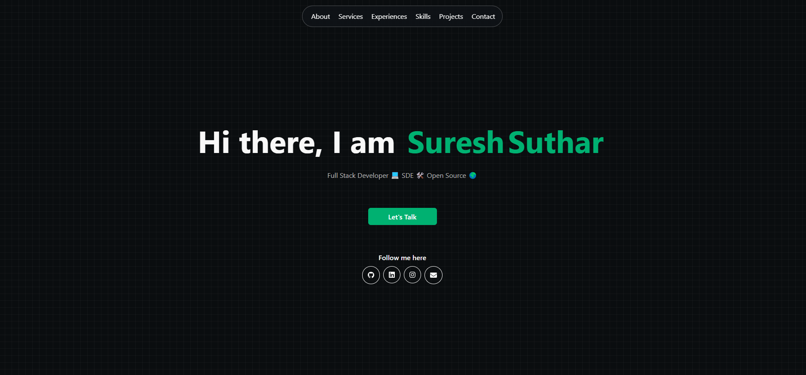

# 🖥️ My Portfolio

Welcome to my personal portfolio! 🚀

I'm **Suresh Suthar**, a passionate **Full Stack Developer**, always excited to create beautiful and functional experiences. Explore my work and get to know me better. 😎

---

## 🔧 Technologies & Tools

Here's a quick rundown of the tools and technologies I use:

- **Languages**: JavaScript, Typescript
- **Frontend**: HTML, CSS, ,React, Next, Angular, Redux Toolkit, Webflow 
- **Backend**: Node.js, Express, Nest.js
- **Styling**: Bootstrap, Tailwind CSS
- **Database**: MySql, Mongodb, Postgres
- **Version Control**: Git, GitHub
- **Deployment**: Docker, AWS 
- **Other**: Firebase, Ubuntu

---

## 📍 Contact Me

Feel free to connect with me through my social media:

- **LinkedIn**: [@suresh-suthar](https://www.linkedin.com/in/suresh-suthar-9838b2255/)
- **Instagram**: [@suresh__suthar](https://www.instagram.com/suresh_suthar_73)
- **GitHub**: [@suthar-suresh](https://github.com/suthar-suresh)
- **Email**: sureshksuthar002@gmail.com

---

## 💬 Let's Connect

Whether you have a project in mind, need advice, or just want to chat, don't hesitate to reach out! 🤗

---

## 🖋️ Quick Note

If you like what you see, please consider starring the repository ⭐! Your support means a lot to me.

---

